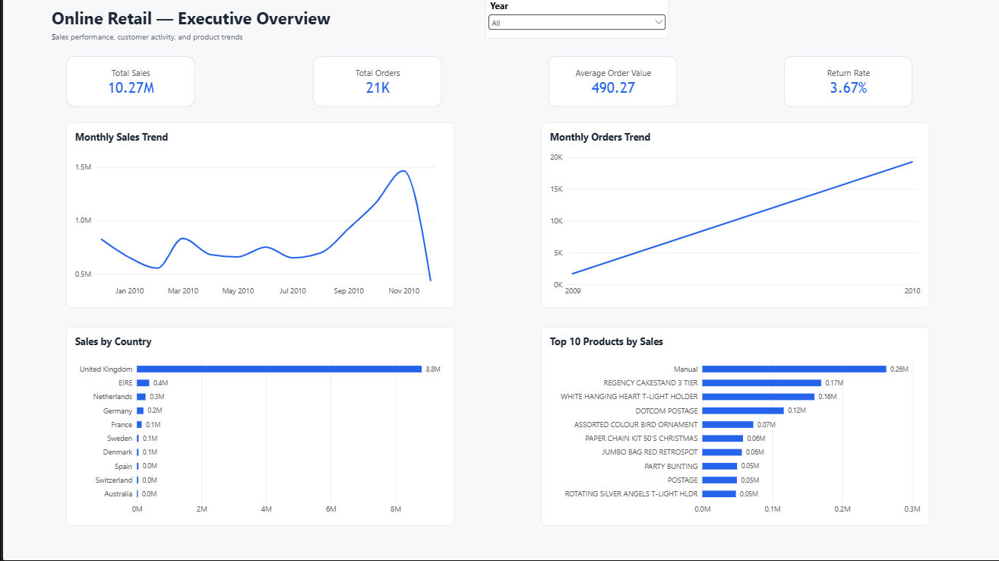
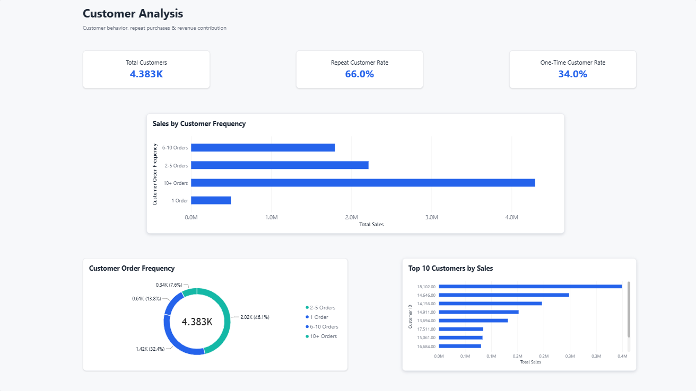
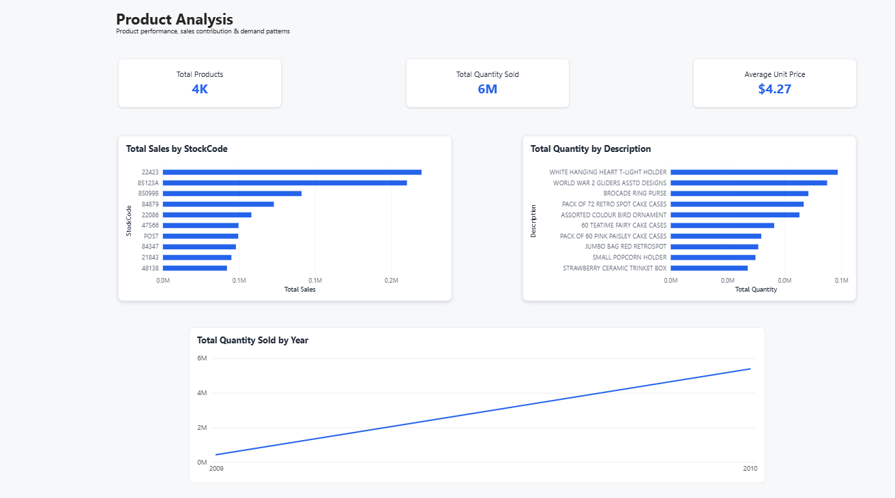
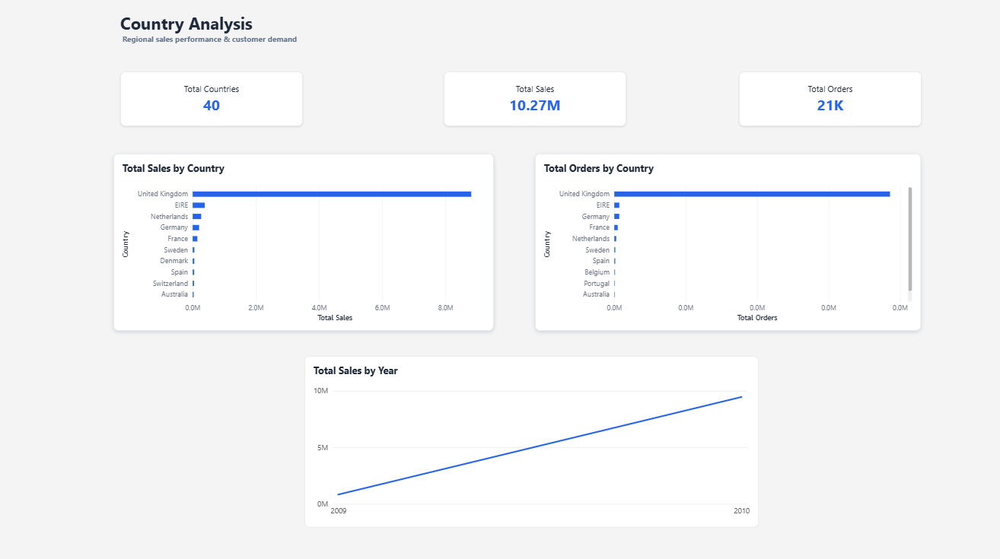

# Online Retail II — End-to-End Data Analysis

## Project Overview

This project analyzes the Online Retail II dataset to understand sales performance, customer purchasing behavior, product demand, and country-level sales patterns.

The goal is to transform raw retail transaction data into actionable business insights that support better business decisions.

## Business Objectives

- Analyze overall sales performance and order trends.
- Understand customer purchasing behavior and repeat purchases.
- Identify top-performing products by sales and quantity.
- Compare sales performance across countries.
- Examine returns and cancellations.
- Build an interactive Power BI dashboard to communicate key findings.

## Tools & Technologies

- **Python:** Data cleaning and preprocessing
- **Pandas:** Data manipulation and data quality checks
- **SQL Server:** Data storage, querying, and business analysis
- **Power BI:** Interactive dashboards and data visualization
- **DAX:** KPI calculations and analytical measures

## Project Workflow

### 1. Data Cleaning — Python & Pandas

- Inspected the raw dataset and its structure.
- Identified and handled duplicate records.
- Investigated missing values and invalid transactions.
- Prepared the cleaned dataset for further analysis.

### 2. Data Analysis — SQL Server

- Analyzed sales and order performance.
- Examined customer purchasing frequency.
- Identified top-performing products.
- Compared sales performance across countries.
- Investigated returns and cancellations.

### 3. Data Visualization — Power BI

Created an interactive dashboard with four analytical pages:

- **Executive Overview:** Overall sales performance and key KPIs.
- **Customer Analysis:** Customer purchasing frequency and sales contribution.
- **Product Analysis:** Product performance and demand patterns.
- **Country Analysis:** Geographic sales comparisons and country-level trends.

## Power BI Dashboard

### Executive Overview



### Customer Analysis



### Product Analysis



### Country Analysis



## Key Business Findings

- Total sales were approximately **10.27 million** in the dataset's transaction currency.
- The United Kingdom was the largest market, generating approximately **8.81 million** in sales.
- Repeat customers represented approximately **66.01%** of customers with identifiable customer IDs, based on the Power BI customer analysis.
- November 2010 recorded the highest monthly sales in the analyzed period.
- Returns and cancellations were important considerations when evaluating sales performance.

## Important Notes

- December 2010 is only partially represented in the analyzed data.
- The dataset does not include product cost information; therefore, profit and profit margin were not calculated.
- The analysis distinguishes sales transactions from returns, cancellations, and other transaction types.

## Dataset

**Online Retail II — UCI Machine Learning Repository**

Dataset source: https://archive.ics.uci.edu/dataset/502/online+retail+ii

The dataset contains retail transactions spanning December 2009 to December 2011. This project analyzes the portion processed in the project workflow.

## Repository Structure

```text
online-retail-ii-analysis/
├── python/
│   └── data_cleaning.ipynb
├── sql/
│   ├── 01_data_validation.sql
│   ├── 02_sales_analysis.sql
│   ├── 03_customer_analysis.sql
│   ├── 04_product_analysis.sql
│   └── 05_country_analysis.sql
├── powerbi/
│   └── Online_Retail_Analysis.pbix
├── images/
│   ├── executive_overview.png
│   ├── customer_analysis.png
│   ├── product_analysis.png
│   └── country_analysis.png
└── README.md
```

*The folder names above illustrate the intended organization. Actual files may vary.*

## Author

**Mohamed Ayman**

Aspiring Data Analyst | Python | SQL Server | Power BI

- GitHub: https://github.com/aymoonm
- LinkedIn: https://www.linkedin.com/in/mohamed-ayman-ds/
